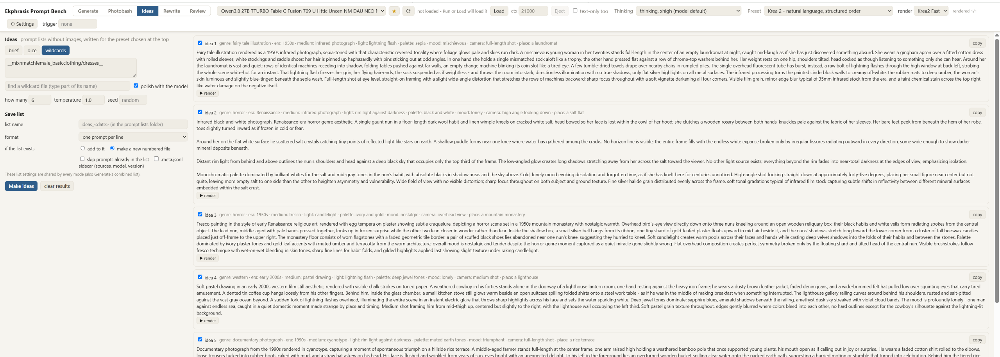

# VLM Prompter

**Image-to-prompt, photobashing, prompt ideas and prompt rewriting with local vision models - plus a review bench for
the renders that come back.**

VLM Prompter is a local web app (and command line) that drives vision-language models running in
[LM Studio](https://lmstudio.ai). Point it at a folder of images and it writes prompts for modern text-to-image models -
Krea 2, MOSS-Image, Ideogram 4, Wan 2.2 and more - in each model's own format. It can fuse several pictures into one new
idea, invent prompts with no image at all, rewrite existing prompts into a different style or model format, and check
the finished renders against their prompts and source images.

Everything runs on your own machine. No cloud, no accounts.

<!-- SCREENSHOT: assets/overview.png - the app with a folder open in Generate mode -->


---

## Highlights

- **Five modes in one app** - Generate, Photobash, Ideas, Rewrite and Review.
- **Model-aware presets** - every prompt is written in the target model's format, order and length (Krea 2's 512-token
  encoder, MOSS-Image's long-form prose, Ideogram 4's structured JSON, Wan 2.2's motion-first video prompts ...).
- **Photobashing in text** - mix 2-4 images (or random picks from whole folders) by weight into one coherent new
  picture. Take everything from a source, or only its pose, palette, setting, era ...
- **Prompts without images** - many distinct takes on a brief, random "dice" rolls of genre / era / medium / light,
  or your own wildcard files.
- **Rewrite** - turn SDXL tag prompts into rich natural language, change a whole list from "vintage illustration" to
  "professional photograph", apply rules, make variations or minimal-edit twin pairs.
- **Review bench** - rate renders, let a vision model check them (does the render follow the prompt? does it match the
  source?), catch reversed poses with pose detectors, and get reports by prompt version, checkpoint or model.
- **Fast with big folders** - a virtual gallery that opens 40,000+ image folders in under a second.
- **Never overwrites** - new numbered files instead; every saved prompt is traceable back to its image, model and
  instructions.

---

## Requirements

- **Windows** (the app is Python and runs elsewhere too, but the launchers are `.bat` files).
- **Python 3.10+** (developed on 3.12).
- **[LM Studio](https://lmstudio.ai)** with a **vision-capable model** (Qwen-VL family models work well), with its local
  server enabled (default `http://localhost:1234`) and the `lms` command-line tool installed.
- A GPU that runs your chosen model in LM Studio. The app itself needs no GPU.

## Installation

```bat
git clone https://github.com/EricRollei/VLM_Prompter.git
cd VLM_Prompter
setup.bat
```

`setup.bat` creates a virtual environment in `.venv` and installs `requirements.txt` (Pillow, PyYAML, gguf).

### Optional: pose and face detectors

Used for measured head directions, the pose check in Review, and the Audit page. They run on the CPU by default.

```bat
.venv\Scripts\python -m pip install -r requirements-detectors.txt
.venv\Scripts\python -m pip install --no-deps rtmlib uniface hsemotion-onnx
```

`--no-deps` stops those packages from replacing a GPU build of onnxruntime with the CPU one. Detector models download
on first use.

## Starting

```bat
run_gui.bat
```

opens the app at **http://127.0.0.1:8790**. Load a vision model in LM Studio (or pick one in the app's model menu and
press **Load**), open a folder of images, and go.

## Settings

Your own settings are stored in `settings.json` in the app folder (created on first change, never part of the
repository). The folders you will most likely want to set:

| Key | What it is | Default |
|---|---|---|
| `group_dir` | where prompt lists are saved | `prompt_lists` in the app folder |
| `wildcards_dir` | folder of `.txt` wildcard files for the Ideas tab | `wildcards` in the app folder |
| `sweeps_dir` | ComfyUI sweep output to review (e.g. `ComfyUI/output/sweeps`) | not set |
| `lmstudio_models_dir` | LM Studio's models folder (used to read each model's chat template) | `~/.lmstudio/models` |
| `load_context_length` | context length used when the app loads a model | 21000 |

Example `settings.json`:

```json
{
  "group_dir": "D:/AI/prompt_lists",
  "wildcards_dir": "D:/AI/wildcards",
  "sweeps_dir": "D:/ComfyUI/output/sweeps"
}
```

---

## The modes

### Generate - images to prompts

<!-- SCREENSHOT: assets/generate.png - gallery + queue with finished prompts -->


1. Browse to a folder (recent folders and drives on the left; the gallery handles very large folders).
2. Select images and **+ Add selected** (or add the whole folder) to the queue.
3. Pick a **preset** (the target model) at the top and press **Run**.

Options for every image in the run: **modifier chips** (ignore text, ignore watermarks, replace subject, change style /
setting / era / lighting / palette, add text, extra detail, free instruction), a run note, and optionally **measured
head directions** from the pose detectors. The **Instructions** tab holds variations, thinking mode, temperature, max
tokens, seed and context length, plus **Compare versions** - several prompt versions per image (presets x with/without
head directions) written into one list for an A/B sweep.

**Saving** - per image (`<name>.prompt.txt` beside the image), per folder, or one combined list, in lines, blocks or
JSONL. The Save tab shows for each file whether it is new, will be added to, or gets a new number. Nothing is ever
overwritten. Prompts cut off at the token limit are retried automatically with a larger budget.

### Photobash - several pictures into one new picture

<!-- SCREENSHOT: assets/photobash.png - three sources (one a folder pool), weights, aspect chips and results -->


Add 2-4 **sources** - images, or **folders as random pools** (a pool can hold several folders; each folder gets an
equal chance). Give each a **weight**. By default a source contributes **everything**; tick aspects (subject, pose,
clothing, setting, light, palette, style, genre, era, mood, composition, texture) to use **only** those from it.

- **blend** - the model fuses all sources at once; the heaviest is the backbone, lighter ones transform it.
- **draw** - for each mix every aspect is drawn from one source with probability = weight. Many mixes, many
  combinations.

The result is always **one coherent scene** - never a collage or double exposure; conflicts between sources are
resolved into a new idea rather than averaged. Master directions: **no text or lettering**, **no signatures /
watermarks / logos**, and **add text** (exact text and where it goes). Results build up until you clear them, and are
written in the chosen preset's format.

### Ideas - prompts without images

<!-- SCREENSHOT: assets/ideas.png - dice mode with rolled ingredients shown on each result -->


- **brief** - many clearly different takes on one brief.
- **dice** - each idea gets a random roll of genre, era, medium, light, palette, mood, camera and place (optionally on
  top of a brief). Odd combinations are the point.
- **wildcards** - templates with `__name__` (your wildcard `.txt` files, with a search box) and `{a|b|c}` choices,
  optionally polished into a full prompt by the model.

### Rewrite - change existing prompts

<!-- SCREENSHOT: assets/rewrite.png - an edit run with one result's diff open -->


Load a prompt list, paste prompts, or send them from the Queue, Photobash or Ideas. Every rewrite comes out in the
chosen preset's format and length.

- **convert** - format only (e.g. SDXL tag prompts with weights into clear, detailed Krea 2 or MOSS prose).
- **edit** - one instruction for the whole list: "change the style to a professional photograph", "make it more
  surreal", "happier", "move it to the 1920s", "replace the subject with ..." - carried through every detail.
- **refine with image** - corrects each prompt against its source image.
- **rules** - apply rules to every prompt ("state which way each person faces").
- **variations** - several different takes per prompt.
- **pair** - minimal-edit twins that differ only in one change, saved as line-aligned `_A` / `_B` lists for blending
  and concept-direction experiments.

**Word choice** - faithful, fresh or bold - steers away from stock phrasing by instruction. **Keep exactly** protects
trigger words and names; quoted text is always kept. Results are reviewed **by exception**: only suspicious ones
(lost protected words, over the token limit, a preamble, unchanged, too short) are flagged; a diff is one click away.

### Review - check what came back

<!-- SCREENSHOT: assets/review.png - a sweep grouped by prompt, detail panel with render, source and vision check -->


Open a ComfyUI sweep folder (from the [Eric_Krea2](https://github.com/EricRollei/Krea2_ComfyUI_Advanced) sweep
system) or any image folder. Renders are grouped by prompt and shown next to their **source image** and the **settings
and instructions** that made the prompt.

- Rate with stars, keeper and defect flags (signature/watermark, unwanted text, unwanted nudity, anatomy, physics,
  extra/missing subject) - all from the keyboard. Notes can be marked as prompt-writing lessons.
- **Check renders** - a vision model scores how well each render **follows its prompt** (checklist per prompt, with
  items beyond the encoder's token limit marked) and how well it **matches the source**, and suggests defects.
- **Pose check** - pose and head-pose detectors catch **reversed poses**, mirror images and broken relationships
  between people that vision models routinely miss.
- **report** - results grouped by prompt version, checkpoint, preset or model, with lesson candidates (renders that
  follow the prompt but differ from the source in one aspect - the prompt left something unsaid).
- **audit** - compares the vision model with the detectors person by person (boxes drawn on the image) so you can see
  which to trust for what.

<!-- SCREENSHOT: assets/report.png - report by version / checkpoint -->

---

## Presets

| Preset | For | Output |
|---|---|---|
| `krea2` | Krea 2 | structured natural language within the 512-token encoder |
| `krea2_v2` | Krea 2 (draft) | physically plausible staging, one light idea, gesture and intent |
| `moss` | MOSS-Image | long, detailed English prose (Qwen3.5 encoder, ~4K tokens) |
| `moss_layout` | MOSS-Image | layout JSON with text and object boxes for a chosen canvas (aspect + megapixels) |
| `ideogram4` | Ideogram 4 | structured JSON with element boxes and hex palette |
| `wan22_i2v` | Wan 2.2 image-to-video | motion and camera only (the image is the first frame) |
| `wan22_t2v` | Wan 2.2 text-to-video | cinematic tags, then scene and motion |

Presets are YAML files in `presets/` - copy one to make your own. Each file names its sources (official prompting
guides) in its header.

## Models and thinking

The app uses whatever LM Studio has loaded, or loads the model you pick. Thinking modes are read from each model's own
chat template (reasoning tags, `reasoning_effort`, or on/off). Templates with a broken reasoning tag are detected and
driven through `reasoning_effort` instead, with a notice in the model row.

## Where things are saved

- **Prompt lists** in `group_dir`, each with a `.meta.jsonl` sidecar (source images, model, preset, version).
- **Provenance** in `runs/saved_index.jsonl` - every saved prompt with its file, source image, model, preset and
  instructions; the Save tab's "Where did a prompt come from?" looks it up.
- **Ratings, checks and detector results** in `review.sqlite`.

## Command line

```bat
vlm.bat run <folder or images> --preset krea2 --out per-image
vlm.bat models
vlm.bat presets
vlm.bat --help
```

## Troubleshooting

- **"Nothing is loaded in LM Studio"** - load a vision model in LM Studio, or choose one in the app and press Load.
- **A model fails with a chat-template error about the reasoning tag** - the app falls back to `reasoning_effort`
  automatically; fixing the template in LM Studio's prompt-template setting restores the tag modes.
- **Prompts come back empty** - thinking models can use the whole token budget on reasoning; lower the thinking mode or
  raise max tokens (the app retries once on its own).

## License

Dual license by Eric Hiss: non-commercial use under a modified CC BY-NC 4.0 with attribution; commercial use by
separate agreement. See [LICENSE.md](LICENSE.md).
