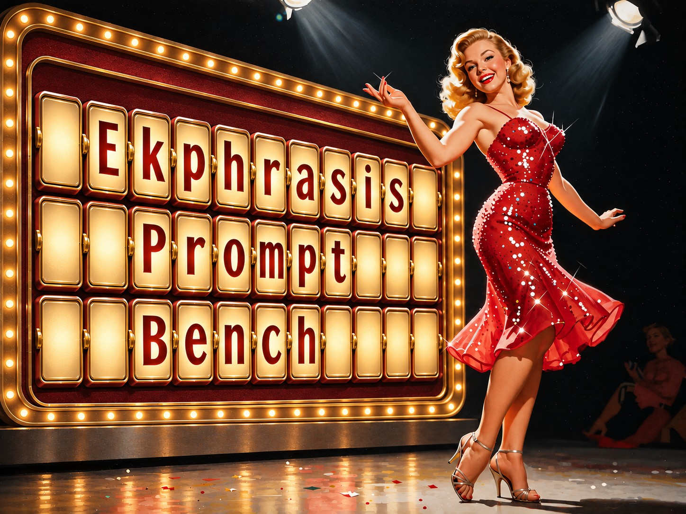
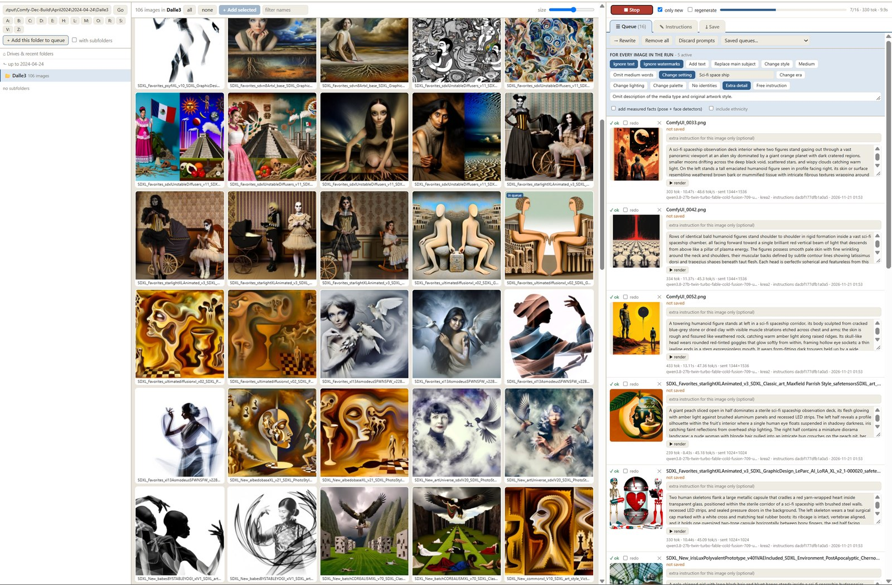
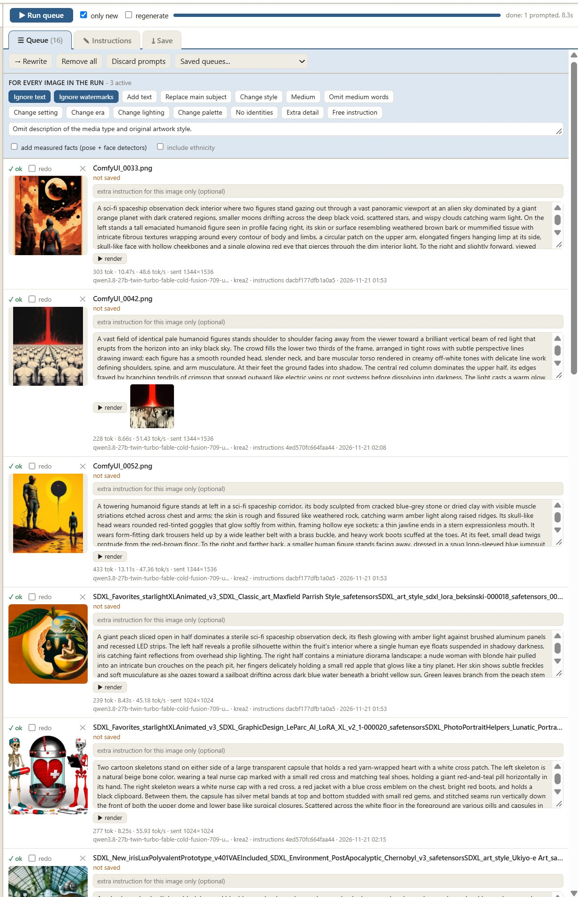
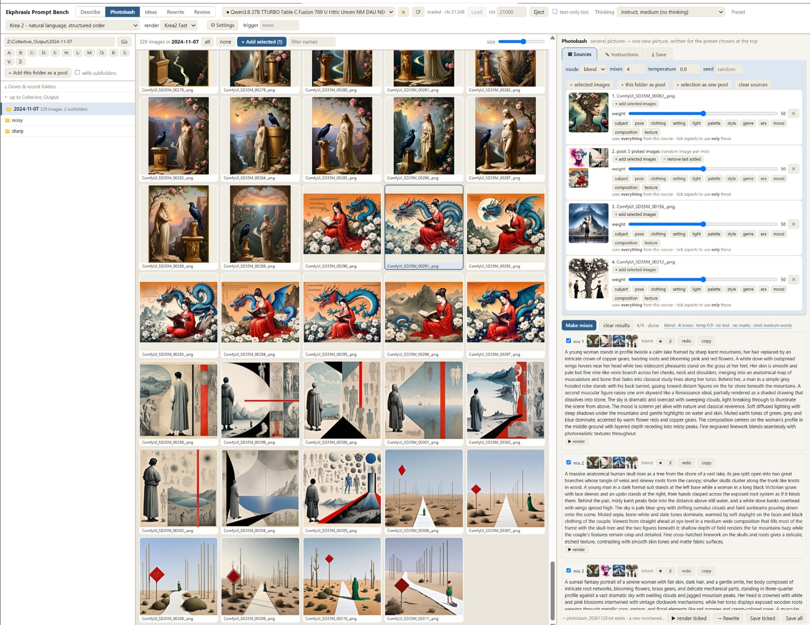
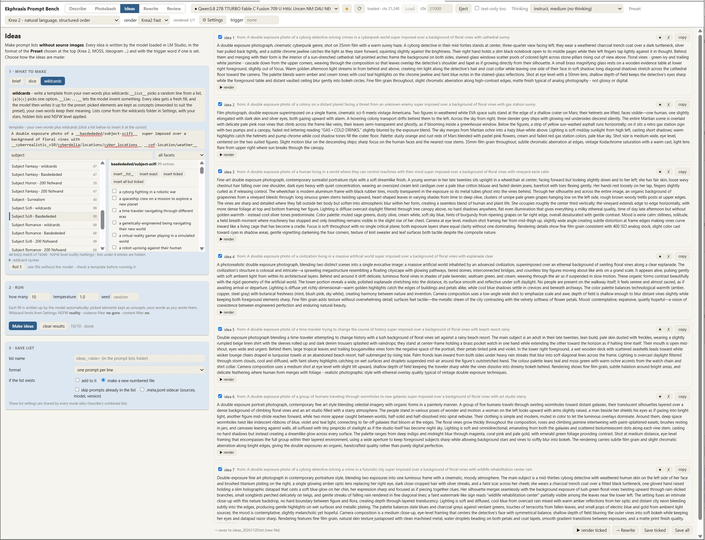
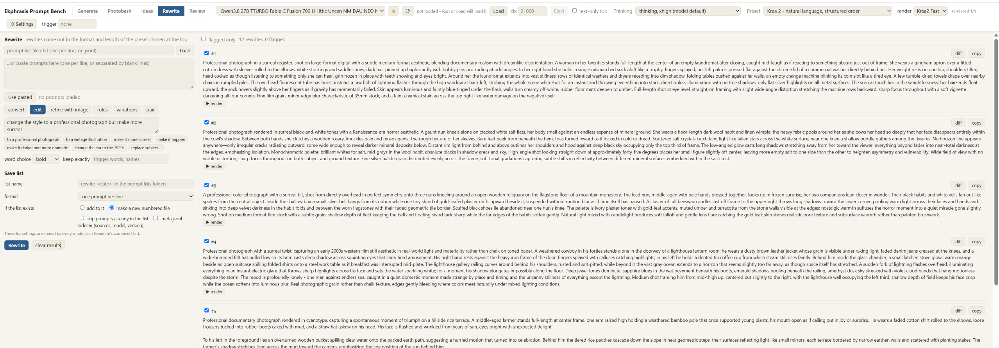

# Ekphrasis Prompt Bench

*Ekphrasis (Greek): the art of describing a work of art in words.*

**Image-to-prompt, photobashing, prompt ideas and prompt rewriting with local vision models - plus a review bench for
the renders that come back.**

Ekphrasis Prompt Bench is a local web app (and command line) that drives vision-language models running in
[LM Studio](https://lmstudio.ai). Point it at a folder of images and it writes prompts for modern text-to-image models -
Krea 2, MOSS-Image, Ideogram 4, Wan 2.2 and more - in each model's own format. It can fuse several pictures into one new
idea, invent prompts with no image at all, rewrite existing prompts into a different style or model format, and check
the finished renders against their prompts and source images.

Everything runs on your own machine. No cloud, no accounts.



*Made with the bench: a Photobash of several source pictures, the brass badge added with "add text", rendered with
Krea 2 straight from the app.*

---

## Highlights

- **Five modes in one app** - Describe, Photobash, Ideas, Rewrite and Review.
- **Model-aware presets** - every prompt is written in the target model's format, order and length (Krea 2's 512-token
  encoder, MOSS-Image's long-form prose, Ideogram 4's structured JSON, Wan 2.2's motion-first video prompts ...).
- **Photobashing in text** - mix 2-4 images (or random picks from whole folders) by weight into one coherent new
  picture. Take everything from a source, or only its pose, palette, setting, era ...
- **Prompts without images** - many distinct takes on a brief, random "dice" rolls of genre / era / medium / light,
  or your own wildcard files.
- **Rewrite** - turn SDXL tag prompts into rich natural language, change a whole list from "vintage illustration" to
  "professional photograph", apply rules, make variations or minimal-edit twin pairs.
- **Render from the bench** - a render button on every prompt sends it to your ComfyUI workflow and shows the image
  under the prompt; edit, render again, compare.
- **LoRA training captions** - a trigger word in front of every prompt and `<name>.txt` captions beside each image.
- **Review bench** - rate renders, let a vision model check them (does the render follow the prompt? does it match the
  source?), catch reversed poses with pose detectors, and get reports by prompt version, checkpoint or model.
- **Fast with big folders** - a virtual gallery that opens 40,000+ image folders in under a second.
- **Never overwrites** - new numbered files instead; every saved prompt is traceable back to its image, model and
  instructions.

---

## Requirements

- **Windows** (the app is Python and runs elsewhere too, but the launchers are `.bat` files).
- **Python 3.10+** (developed on 3.12).
- **[LM Studio](https://lmstudio.ai)** with a **vision-capable model** (Qwen-VL family models work well), with its local
  server enabled (default `http://localhost:1234`) and the `lms` command-line tool installed.
- A GPU that runs your chosen model in LM Studio. The app itself needs no GPU.

## Installation

```bat
git clone https://github.com/EricRollei/Ekphrasis-Prompt-Bench.git
cd Ekphrasis-Prompt-Bench
setup.bat
```

`setup.bat` creates a virtual environment in `.venv` and installs `requirements.txt` (Pillow, PyYAML, gguf).

### Optional: pose and face detectors

Used for measured head directions, the pose check in Review, and the Audit page. They run on the CPU by default.

```bat
.venv\Scripts\python -m pip install -r requirements-detectors.txt
.venv\Scripts\python -m pip install --no-deps rtmlib uniface hsemotion-onnx
```

`--no-deps` stops those packages from replacing a GPU build of onnxruntime with the CPU one. Detector models download
on first use.

## Starting

```bat
run_gui.bat
```

opens the app at **http://127.0.0.1:8790**. Load a vision model in LM Studio (or pick one in the app's model menu and
press **Load**), open a folder of images, and go.

## Settings

Your own settings are stored in `settings.json` in the app folder (created on first change, never part of the
repository). The folders you will most likely want to set:

| Key | What it is | Default |
|---|---|---|
| `group_dir` | where prompt lists are saved | `prompt_lists` in the app folder |
| `wildcards_dir` | folder of `.txt` wildcard files for the Ideas tab | `wildcards` in the app folder |
| `sweeps_dir` | ComfyUI sweep output to review (e.g. `ComfyUI/output/sweeps`) | not set |
| `lmstudio_models_dir` | LM Studio's models folder (used to read each model's chat template) | `~/.lmstudio/models` |
| `load_context_length` | context length used when the app loads a model | 21000 |

Example `settings.json`:

```json
{
  "group_dir": "D:/AI/prompt_lists",
  "wildcards_dir": "D:/AI/wildcards",
  "sweeps_dir": "D:/ComfyUI/output/sweeps"
}
```

---

Most settings can also be changed in the app: **Settings** in the top bar (folders, ComfyUI, workflows, render
presets). The render keys are `comfyui_url`, `render_gpu` (`shared` or `separate`) and `render_free_after`.

## The modes

### Describe - images to prompts



1. Browse to a folder (recent folders and drives on the left; the gallery handles very large folders).
2. Select images and **+ Add selected** (or add the whole folder) to the queue.
3. Pick a **preset** (the target model) at the top and press **Run**.

Options for every image in the run: **modifier chips** (ignore text, ignore watermarks, replace subject, change style /
setting / era / lighting / palette, add text, extra detail, free instruction), a run note, and optionally **measured
head directions** from the pose detectors. The **Instructions** tab holds variations, thinking mode, temperature, max
tokens, seed and context length, plus **Compare versions** - several prompt versions per image (presets x with/without
head directions) written into one list for an A/B sweep.



**Saving** - per image (`<name>.prompt.txt` beside the image), per folder, or one combined list, in lines, blocks or
JSONL. The Save tab shows for each file whether it is new, will be added to, or gets a new number. Nothing is ever
overwritten. Prompts cut off at the token limit are retried automatically with a larger budget.

**Modifier chips** include **Medium** (force a medium such as "35mm film photograph") and **Omit medium words**
(the prompt names no medium, camera or brush terms - leave the medium to the model or a style LoRA). The same chips
are available in Photobash.

**Trigger word** - a field in the top bar puts a LoRA trigger at the very front of every prompt, ended with a period
(`ohwx woman. A woman stands ...`), in every mode. It is added in code after the model writes, so it is exact and never
doubled.

**Training captions** - an extra Save target writes the first prompt of each image as `<name>.txt` beside it, the form
ai-toolkit, kohya and OneTrainer read. An existing caption is never overwritten; it is skipped and counted.

### Photobash - several pictures into one new picture



Add 2-4 **sources**: single images, a **folder as a pool** (a random image per mix; a pool can hold several folders,
each with an equal chance), or **a selection as one pool** (pick a hand-chosen subset of a folder in the gallery -
no new folder needed). Give each source a **weight**. The panel has three tabs - **Sources**, **Instructions**,
**Save** - and the basics (mode, number of mixes, temperature, seed) stay visible on all of them.

The result is always **one coherent picture** - never a collage or a double exposure. Where sources conflict, the
model resolves the conflict into a new idea instead of averaging it away.

#### Aspects

A picture is described through twelve **aspects**: subject, pose, clothing, setting, light, palette, style, genre,
era, mood, composition and texture.

- By default every source **offers all twelve**.
- Tick aspects on a source and it offers **only those** ("use only its style and palette").
- An aspect that **no source offers is invented by the model**. To build the new picture only from your sources,
  either tick nothing anywhere, or make sure **every aspect is ticked on at least one source**. Leaving aspects
  unticked everywhere is also a tool: the model fills them in freshly on every mix.

#### Blend and draw

- **blend** - sources that offer the same aspect are **mixed by weight**. The heaviest source is the backbone; lighter
  ones transform it. At equal weights the model makes a true hybrid.
- **draw** - as in drawing a card: for every mix, each aspect is **drawn from one of the sources that offer it**, with
  the weights as the odds. The draw is shown on each result (`subject:2 light:3 ...`), so a good mix tells you which
  aspect came from where.

The two modes only differ where **aspects overlap** (two or more sources offer the same aspect):

| | blend | draw |
|---|---|---|
| an aspect offered by several sources | their versions are mixed, by weight | one of them is chosen per mix, by weight |
| an aspect offered by one source | taken from it | taken from it - every mix, no randomness |
| an aspect offered by no source | invented by the model | invented by the model |
| what the weight means | share of influence | odds of being drawn |
| typical number of mixes | 2-6 | 12-36+ |

So with **nothing ticked**, draw deals all twelve aspects among the sources independently on every mix - the
strongest "mix them up" setting. If every aspect is ticked on **exactly one** source, there is nothing to draw:
both modes take the same aspects from the same sources every time, and variety comes only from the model's sampling
and from pool picks.

**Example - subject ticked on all three sources, nothing else:**
- **blend**: the three subjects are fused into one new hybrid subject; setting, light, style and the rest are
  invented. (To show them together as separate figures instead, say so in the note.)
- **draw**: each mix takes the subject of **one** source - the others take turns on later mixes - and places it in an
  invented scene.

#### A way to work

1. **Explore** with draw, nothing ticked, folder or selection pools, 24-36 mixes.
2. **Render** the promising ones (render ticked) and read their aspect draws.
3. **Refine** with blend: the winning sources, with "use only" ticks on what each should give, a few mixes.
4. **Redo** any single mix that came close - same pictures and same draw, new seed. Runaway text (a model stuck in a
   repetition loop) is caught automatically: one silent retry, then a flag on the card.

#### Instructions tab

- **no text or lettering**, **no signatures / watermarks / logos**, and **add text** (exact text, plus where it goes).
- **Modifier chips** shared with Describe - change style, setting, era, lighting or palette, replace the subject,
  **Medium** (e.g. "35mm film photograph", whatever the sources are) or **Omit medium words** (no medium, camera or
  brush terms in the prompt), extra detail, free instruction.
- A free **note**, a **max tokens** override, and **what the model is told** - a live preview of the exact
  instructions and picture labels for one mix.

#### Save tab

The shared list settings (also used by Ideas, Rewrite and Describe's combined list): list name, format (one prompt per
line, blocks, or JSON lines with sources and model), add to an existing list or make a new numbered file, skip
prompts already in the list, and a `.meta.jsonl` sidecar recording the sources, weights and draw of every prompt. The
row at the bottom shows where the next save goes.

#### How it works

Each mix is **one call to the vision model**. The app first decides the random parts in code (which image each pool
contributes, and in draw mode which source each aspect comes from), then sends all the source images together in one
message - each labelled with its weight and "use only" aspects, or with the list of drawn aspects - along with the
photobash instructions and the preset's format rules. The model sees the pictures directly and writes the new prompt
in one pass; there is no captioning step and no mixing of image embeddings. Each source image costs part of the
model's context, so two or three sources are cheaper and often more coherent than four.

### Ideas - prompts without images



Prompt lists without source images, written by the loaded model in the chosen preset's format.

- **brief** - a theme or scene in a few words; the model writes as many clearly different takes as you ask for.
- **dice** - every idea gets a random roll of ingredients (genre, era, medium, light, palette, mood, camera, place) and
  the model builds one coherent picture from it. Add a brief to keep a theme.
- **wildcards** - a template of your own words plus wildcards, filled fresh for every idea and then written up by the
  model. The model is told which parts were picked at random and which are your words: picks are kept as concepts
  (reworded to suit the preset), your words keep their meaning, and `__llm:...__` slots are invented by the model.

The wildcard engine is the one from the
[video_prompter](https://github.com/EricRollei/Local_LLM_Prompt_Enhancer) nodes (vendored in `vlm_prompter/wildcards`,
refreshed with `tools/sync_wildcards.py`): Dynamic Prompts compatible syntax plus weights, multi-select, exclusions
(`__list!{a|b}__`), variables, conditionals, exact (`__=list__`) and loose (`__?list__`) picks, and LLM slots. A
**wildcard browser** searches the lists in your wildcards folder (by name, entries and facet - wardrobe, lighting,
setting ...), previews a list's entries, and inserts the list, a ticked subset (`{a|b}`) or "all but ticked" at the
cursor. **Roll 5** shows raw fills without the model, and any fill can be used as it is.

The catalog (`_catalog.sqlite`) and your curation (`_catalog_user.yaml`: stars, hidden lists, dropped entries) live in
the wildcards folder itself, so the same stars and hidden lists apply in video_prompter. The NSFW level, violence
filter and content filter are set once in **Settings**.

### Rewrite - change existing prompts



Load a prompt list, paste prompts, or send them from the Queue, Photobash or Ideas. Every rewrite comes out in the
chosen preset's format and length.

- **convert** - format only (e.g. SDXL tag prompts with weights into clear, detailed Krea 2 or MOSS prose).
- **edit** - one instruction for the whole list: "change the style to a professional photograph", "make it more
  surreal", "happier", "move it to the 1920s", "replace the subject with ..." - carried through every detail.
- **refine with image** - corrects each prompt against its source image.
- **rules** - apply rules to every prompt ("state which way each person faces").
- **variations** - several different takes per prompt.
- **pair** - minimal-edit twins that differ only in one change, saved as line-aligned `_A` / `_B` lists for blending
  and concept-direction experiments.

**Word choice** - faithful, fresh or bold - steers away from stock phrasing by instruction. **Keep exactly** protects
trigger words and names; quoted text is always kept. Results are reviewed **by exception**: only suspicious ones
(lost protected words, over the token limit, a preamble, unchanged, too short) are flagged; a diff is one click away.

### Review - check what came back

<!-- screenshot to come: assets/review.png -->

Open a ComfyUI sweep folder (from the [Eric_Krea2](https://github.com/EricRollei/Krea2_ComfyUI_Advanced) sweep
system) or any image folder. Renders are grouped by prompt and shown next to their **source image** and the **settings
and instructions** that made the prompt.

- Rate with stars, keeper and defect flags (signature/watermark, unwanted text, unwanted nudity, anatomy, physics,
  extra/missing subject) - all from the keyboard. Notes can be marked as prompt-writing lessons.
- **Check renders** - a vision model scores how well each render **follows its prompt** (checklist per prompt, with
  items beyond the encoder's token limit marked) and how well it **matches the source**, and suggests defects.
- **Pose check** - pose and head-pose detectors catch **reversed poses**, mirror images and broken relationships
  between people that vision models routinely miss.
- **report** - results grouped by prompt version, checkpoint, preset or model, with lesson candidates (renders that
  follow the prompt but differ from the source in one aspect - the prompt left something unsaid).
- **audit** - compares the vision model with the detectors person by person (boxes drawn on the image) so you can see
  which to trust for what.


---

## Rendering with ComfyUI

Every prompt card - in the queue, Photobash, Ideas and Rewrite - has a **render** button. It sends the prompt (as you
have edited it) to a ComfyUI workflow and shows the result as a thumbnail strip under the prompt; render again after an
edit and compare. Photobash, Ideas and Rewrite also have **render ticked** for a batch. A pulsing pill in the top bar
shows progress and has a stop link.

Setting it up, in **Settings** (top bar):

1. **ComfyUI address** - default `http://127.0.0.1:8188`.
2. **Workflows** - run your workflow once in ComfyUI, then *save my last ComfyUI run as ...*. The app reads it from
   ComfyUI's history in API form and maps its fields automatically (a text node titled like "prompt", the seed, the
   negative, width and height); check or change the mapping on the same page.
3. **Render presets** - a workflow plus images per click, seed (random, or fixed to compare prompt edits fairly), an
   optional size and negative. Pick the preset in the top bar's **render** menu.

**One GPU or two.** With *one GPU*, the app unloads the LM Studio model while rendering and reloads it automatically when
the next prompt job starts, and can ask ComfyUI to free its memory after a batch. With *separate GPUs* both run at
once - prompts are written while images render.

**Batches load models once.** If your workflow ends with an unload-models node, the app leaves it out of every render
in a batch except the last, so checkpoints and LoRAs stay loaded between images and unload once at the end.

Renders are copied into `renders/` (and kept by ComfyUI as usual); each is linked to its prompt so its strip comes back
later. Workflows, render presets and renders live in folders that are not part of the repository.

## Presets

| Preset | For | Output |
|---|---|---|
| `krea2` | Krea 2 | structured natural language within the 512-token encoder |
| `krea2_v2` | Krea 2 (draft) | physically plausible staging, one light idea, gesture and intent |
| `moss` | MOSS-Image | long, detailed English prose (Qwen3.5 encoder, ~4K tokens) |
| `moss_layout` | MOSS-Image | layout JSON with text and object boxes for a chosen canvas (aspect + megapixels) |
| `ideogram4` | Ideogram 4 | structured JSON with element boxes and hex palette |
| `wan22_i2v` | Wan 2.2 image-to-video | motion and camera only (the image is the first frame) |
| `wan22_t2v` | Wan 2.2 text-to-video | cinematic tags, then scene and motion |

Presets are YAML files in `presets/` - copy one to make your own. Each file names its sources (official prompting
guides) in its header.

## Models and thinking

The app uses whatever LM Studio has loaded, or loads the model you pick. Thinking modes are read from each model's own
chat template (reasoning tags, `reasoning_effort`, or on/off). Templates with a broken reasoning tag are detected and
driven through `reasoning_effort` instead, with a notice in the model row.

## Where things are saved

- **Prompt lists** in `group_dir`, each with a `.meta.jsonl` sidecar (source images, model, preset, version).
- **Provenance** in `runs/saved_index.jsonl` - every saved prompt with its file, source image, model, preset and
  instructions; the Save tab's "Where did a prompt come from?" looks it up.
- **Ratings, checks and detector results** in `review.sqlite`.

## Command line

```bat
vlm.bat run <folder or images> --preset krea2 --out per-image
vlm.bat models
vlm.bat presets
vlm.bat --help
```

## Troubleshooting

- **"Nothing is loaded in LM Studio"** - load a vision model in LM Studio, or choose one in the app and press Load.
- **A model fails with a chat-template error about the reasoning tag** - the app falls back to `reasoning_effort`
  automatically; fixing the template in LM Studio's prompt-template setting restores the tag modes.
- **Prompts come back empty** - thinking models can use the whole token budget on reasoning; lower the thinking mode or
  raise max tokens (the app retries once on its own).

## License

Dual license by Eric Hiss: non-commercial use under a modified CC BY-NC 4.0 with attribution; commercial use by
separate agreement. See [LICENSE.md](LICENSE.md).
